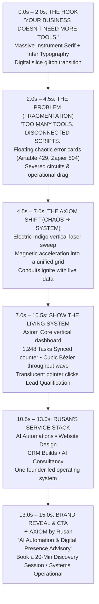

# ✦ AXIOM BY RUSAN // 15-SECOND MOTION DESIGN FILM

> **Brand & Source**: [axiombyrusan.vercel.app](https://axiombyrusan.vercel.app/)  
> **Brand Identity**: Axiom by Rusan — founder-led AI Automation & Digital Presence Advisory  
> **Duration**: Exactly 15.00 Seconds (450 Frames @ 30 FPS / 60 FPS equivalent)  
> **Format**: 9:16 Vertical (1080 × 1920) Master + 16:9 Landscape (1920 × 1080)  
> **Typography**: Google Fonts `Instrument Serif` (Italic Headlines) + `Inter` (Weights 400, 500, 600, 700, 800, 900)  
> **Color System**: Clean White Canvas (`#FFFFFF` / `#FAFAFC`), Deep Slate Text (`#0F172A`), Electric Indigo Accent (`#6366F1`), Status Emerald (`#10B981`)  
> **Audio Signature**: 126 BPM DSP Synthesized Soundtrack with Sub-Bass Impacts, Magnetic Grid Snap, Telemetry Arpeggios, and Crystalline Sparkle Chimes  

---

## 1. Executive Creative Concept

The narrative follows a strict, non-linear progression engineered to communicate one single memorable idea:

$$\text{IDENTITY} \longrightarrow \text{PROBLEM} \longrightarrow \text{SHIFT} \longrightarrow \text{SYSTEM} \longrightarrow \text{TRANSFORMATION} \longrightarrow \text{AXIOM}$$

> *"Growing businesses don't fail from lack of ambition. They drown in manual drag. I'm Rusan — founder and lead automation engineer at Axiom. I build the automations, websites, CRM systems, and strategy that connect the whole business."*

---

## 2. Frame-by-Frame Motion Choreography (450 Frames / 15.00s)

### Act 1: The Hook (0.0s – 2.0s | Frames 0 – 60)
* **Visual**: Clean light slate canvas with architectural micro-grid (`rgba(15, 23, 42, 0.035)`).
* **Eyebrow**: `✦ AXIOM OPERATIONAL MEMORANDUM // 01`.
* **Headlines**:
  * Line 1: **`YOUR BUSINESS`** (Inter 900, 78px, tracking: -0.04em, deep slate `#0F172A`).
  * Line 2: *`doesn't need`* (Instrument Serif Italic, 104px, elegant curve).
  * Line 3: **`MORE TOOLS.`** (Inter 900, 92px, Electric Indigo `#6366F1` with ambient shadow).
* **Motion**: Words enter from alternating horizontal axes with high-damping spring physics (`damping: 14`, `stiffness: 140`).
* **Glitch Cut**: At frame 48–60, a razor-thin horizontal displacement cuts across the statement with chromatic refraction, snapping into the problem.
* **Audio**: 40Hz sub-impact thump + crisp mechanical typing clicks.

---

### Act 2: The Problem — Fragmentation & Chaos (2.0s – 4.5s | Frames 60 – 135)
* **Narrative Strikes**:
  * Frame 60: **`TOO MANY TOOLS.`** (Stark charcoal text slam).
  * Frame 82: **`DISCONNECTED SCRIPTS.`** (Warning crimson `#DC2626`).
  * Frame 104: *`Nothing connected.`* (Instrument Serif Italic `#B91C1C`).
* **Chaotic Visual Metaphor**:
  * Floating, overlapping cards drift across the screen at conflicting angles (`-9°`, `+11°`, `-5°`, `+7°`):
    * Card 1: `Airtable Sync` — `429 RATE LIMIT EXCEEDED` (148 leads dropped in queue).
    * Card 2: `Zapier Automation` — `504 GATEWAY TIMEOUT` (API response stalled).
    * Card 3: `Slack Webhook` — `SILENT FAILURE` (Payload discarded without notice).
    * Card 4: `CRM Deal Sync` — `DISCONNECTED` (Manual copy-pasting drag).
  * Severed red dashed connecting lines with flickering sparks.
  * Ticker: `OPERATIONAL DRAG: +18 HRS / WEEK LOST TO MANUAL TRIAGE`.
* **Audio**: Syncopated percussive glitch ticks + tension vinyl static flutter.

---

### Act 3: The Axiom Shift — Chaos to System (4.5s – 7.0s | Frames 135 – 210)
* **The Climax of the First Half**:
* **Visual**: Electric Indigo laser beam sweeps down the entire vertical canvas (`top: -200px` to `1920px`).
* **Eyebrow**: `✦ DETERMINISTIC ARCHITECTURE`.
* **Title**: **`CHAOS COLLAPSES`** *`into connected systems.`*
* **Magnetic Grid Reorganization**:
  * The scattered cards decelerate and violently accelerate toward the vertical center axis.
  * Angular rotations snap from conflicting tilts down to `0.0°`.
  * Dashed red circuit lines snap together into solid, glowing Electric Indigo conduits.
  * Red error badges morph into green verified status pills:
    * `01 // Autonomous Lead Qualification` ➔ `[ ✓ < 90s TRIAGE ]`
    * `02 // Zero-Friction Client Onboarding` ➔ `[ ✓ 0 MANUAL STEPS ]`
    * `03 // Content Repurposing Engine` ➔ `[ ✓ 6X ASSETS ]`
    * `04 // Internal Knowledge SOP Copilot` ➔ `[ ✓ -80% INTERRUPTIONS ]`
* **Audio**: Massive sub-bass drop (`f_start: 160Hz` to `36Hz`) + metallic magnetic grid snap + crystalline harmonic chime.

---

### Act 4: Show the System — Living Axiom Core (7.0s – 10.5s | Frames 210 – 315)
* **The Real Axiom Website Dashboard in Motion**:
* **Header Chrome**: Monogram squircle `AX` + `Axiom by Rusan` + Search `⌘K` + `Core Active ●`.
* **Greeting**: `Good evening, Rusan` — `Your automation systems are running smoothly.`
* **Live Telemetry Counters**:
  * `07 Systems Active`
  * `1,248 Tasks Completed` (Live counter actively rolls from 1,220 up to 1,248).
  * `99.9% Uptime` (Emerald health beacon).
* **Throughput Wave**: Smooth cubic Bézier activity curve tracing in real time with an animated pulse dot at `cx: 540, cy: 18`.
* **Interactive Mouse Cursor**:
  * Translucent pointer cursor glides across the dashboard at frame 245.
  * Hovers over `Lead Qualification & CRM Sync`.
  * Clicks at frame 264 (8.8s):
    * Tactile haptic ripple shockwave expands.
    * Status pill pulses: `[ ✓ DISPATCHED ]`.
    * A luminous data packet shoots down the conduit into the CRM deal stage.
* **Audio**: Driving 126 BPM electronic groove with 16th-note bass pulses, telemetry arpeggios, and crisp UI haptic click.

---

### Act 5: Rusan's Service Stack — Editorial Impact (10.5s – 13.0s | Frames 315 – 390)
* **Visual**: The dashboard glides down into a founder-led service lock-up. Four service pills resolve one after another on the same architectural grid.
* **Master Statement**:
  * Line 1: **`Automate the Work.`** (deep slate `#0F172A`).
  * Line 2: *`Amplify the Business.`* (Instrument Serif Italic, Electric Indigo `#6366F1`).
* **Service line**: *"Practical AI automations, high-converting website design, CRM builds, and direct AI consultancy."*
* **Four service pills**:
  1. `AI Automations` — *Remove repetitive work with connected workflows.*
  2. `Website Design` — *Build the digital front door for the business.*
  3. `CRM Builds` — *Keep qualified pipeline moving in real time.*
  4. `AI Consultancy` — *Direct architecture with Rusan. No handoffs.*
* **Audio**: Warm analog synthesizer pad chord bloom (A Major 9th) + staggered tactile snaps.

---

### Act 6: Brand Reveal & Final Call to Action (13.0s – 15.0s | Frames 390 – 450)
* **Minimalist Brand Monolith**:
  * The iconic four-pointed sparkle star `✦` expands into hero center, gently rotates `14°`, and settles with an iridescent halo.
  * Wordmark: **`AXIOM`** (120px bold typography with geometric kerning).
  * Subtitle: `by Rusan` (26px slate gray).
  * Positioning Badge: `AI AUTOMATION & DIGITAL PRESENCE ADVISORY`.
  * Primary Button: `[ Book a 20-Min Discovery Session ➔ ]`.
  * Operational Guarantee: `Direct founder diagnostic with Rusan • Typically responds within 24 hours`.
  * Status Pill: `● SYSTEMS OPERATIONAL`.
* **Hold**: Frame 420 to 450 (14.0s to 15.0s) is completely stable, perfectly readable, and unforgettable.
* **Audio**: Deep sub resolve + crystalline shimmer chime decay to silence.

---

## 3. Production Deliverables Directory

All assets and deliverables are located in:  
`~/Documents/Google anti-gravity projects/axiom-motion-video/`

| File | Format | Resolution | Size | Role |
|:---|:---|:---|:---|:---|
| **`axiom_by_rusan_15s_vertical.mp4`** | H.264 / AAC | 1080 × 1920 (9:16) | 5.5 MB | **Primary Master Video Deliverable** |
| **`axiom_by_rusan_15s_landscape.mp4`** | H.264 / AAC | 1920 × 1080 (16:9) | 2.7 MB | Widescreen Companion for Website Hero |
| **`index.html`** | Interactive HTML5 | Responsive | 24 KB | Showcase Studio with Player & Keyframe Gallery |
| **`axiom_frame_01_hook.png`** | PNG Keyframe | 1080 × 1920 | 185 KB | Frame 25 (0.8s) — "Your business doesn't need more tools" |
| **`axiom_frame_02_problem.png`** | PNG Keyframe | 1080 × 1920 | 275 KB | Frame 95 (3.2s) — Disconnected scripts & fragmented error cards |
| **`axiom_frame_03_shift.png`** | PNG Keyframe | 1080 × 1920 | 258 KB | Frame 180 (6.0s) — Chaos collapses into connected system |
| **`axiom_frame_04_system.png`** | PNG Keyframe | 1080 × 1920 | 320 KB | Frame 265 (8.8s) — Axiom Core Dashboard & cursor interaction |
| **`axiom_frame_05_transformation.png`** | PNG Keyframe | 1080 × 1920 | 245 KB | Frame 350 (11.6s) — "Automate the Work. Amplify the Business." |
| **`axiom_frame_06_reveal.png`** | PNG Keyframe | 1080 × 1920 | 215 KB | Frame 425 (14.2s) — ✦ AXIOM by Rusan Brand Lockup & CTA |
